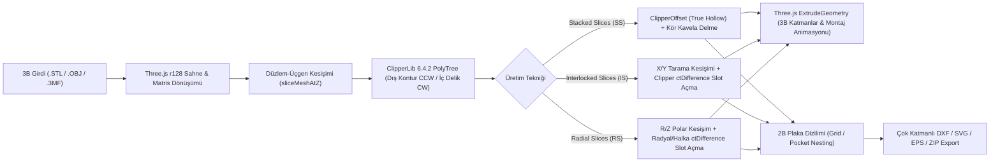

# OpenSlicer Studio

**OpenSlicer Studio**, Autodesk® *Slicer for Fusion 360* (eski adıyla *123D Make*) uygulamasının modern, tarayıcı tabanlı (Zero-Install / Single-File HTML) yeniden yorumlanması ve geliştirilmiş açık mimarili alternatifidir. 3B modelleri (`.STL`, `.OBJ`, `.3MF`) lazer kesim, CNC router veya karton/ahşap maket üretimi için 2B kesim planlarına (`.DXF`, `.SVG`, `.EPS`) dönüştürür.

OrcaSlicer / Bambu Studio'nun modern 3B sahne araçlarını (*3B Dışbükey Zarf ile Yüzeye Oturtma*, *Sabit Çentikli İletki Gimbalı*) ve Autodesk Slicer'ın üretim odaklı dilimleme/geçme motorunu tek bir bağımsız dosyada birleştirir.

---

## 🚀 Temel Özellikler

### 1. Üç Farklı Üretim Tekniği (Construction Techniques)
* **Stacked Slices (`SS` - Üst Üste Yığılmış Katmanlar):**
  * Modeli belirlenen malzeme kalınlığına (`Material Thickness`) ve katman atlama (`Skip Layers`) değerine göre paralel düzlemlerle dilimler.
  * **Parametrik Kabuk / Oyma (True Hollow):** `ClipperLib.ClipperOffset` kullanarak her katmanda gerçek paralel iç ofset hesaplar; alt ve üst kapak katmanlarını otomatik korur.
  * **Akıllı Kavela / Pim Sistemi (Dual-Plane Blind Dowels):** Modelin üst ve alt çalışma düzlemleri arasında sürüklenebilir kavelalar oluşturur. En üst geçerli katmanı "kör delik kapağı" (blind-hole cap) olarak bırakır, çoklu bağımsız blokları destekler ve kavela kesim boyu listesini (*Dowel Cut Summary*) otomatik çıkarır.
* **Interlocked Slices (`IS` - Geçmeli Izgara / Waffle):**
  * Modeli birbirine dik `X` ve `Y` eksenlerinde dilimler ve her `(X_i, Y_j)` kesişiminde yarı-yarıya (*halving joint*) geçme yuvaları (slotlar) açar.
  * **Fiziksel Montaj Sırası:** `Y` dilimleri (`Y-1..Y-m`) masaya ilk dizilen taban ızgarası olarak üstten aşağıya (*top-down*) slot alır; `X` dilimleri (`X-1..X-n`) ise üstten (`+Z`) aşağıya doğru takılacak şekilde alttan yukarıya (*bottom-up*) slot alır.
  * **Slot Karşılık Kılavuz Etiketleri:** Her geçme yuvasının dibine, o yuvaya hangi karşı parçanın gireceğini gösteren kılavuz kodlar (`Y-3`, `X-2` vb.) yazar.
  * **CNC Köşe Boşaltma (Corner Relief) & Pah:** Slot diplerine CNC uç çapına (`Tool Diameter`) göre **T-Bone** veya **Dog Bone** boşaltması ve slot ağzına **Notch Factor** giriş pahı uygular.
  * **Eksen Boyunca Kaydırma (Linear Rib Sliding):** Seçilen herhangi bir `X` veya `Y` dilimi 3B sahnede fareyle sürüklenerek veya sağ paneldeki slider ile kendi ekseninde kaydırılabilir ve parça bazlı (`↺`) sıfırlanabilir.
* **Radial Slices (`RS` - Işınsal & Dairesel Dilimleme):**
  * Modeli dikey merkez ekseni etrafında açılı ışınsal kanatlar (`R-1..R-n`) ve yatay dairesel halkalar (`Z-1..Z-m`) ile dilimler.
  * **Açıdan Bağımsız Yarı-Yarıya Geçmeler:** Dairesel halkalar dışarıdan içeriye doğru açılan radyal slotlar alır; düşey kanatlar ise göbekten dışarıya açılan yatay slotlar alır.
  * **Köşe Boşaltma ve Pah:** Waffle modundaki tüm CNC parametreleri (T-Bone, Dog-Bone, Notch Factor giriş pahı) radyal ve dairesel slotlarda da eksiksiz çalışır.
  * **Radyal Montaj Animasyonu:** Parçalar takılırken düşey kanatlar dışarıdan merkeze doğru $(\cos\theta_i, \sin\theta_i, 0)$ doğrultusunda radyal kayma hareketi ile yerleşir.

---

### 2. CAD Entegrasyonu & Evrensel Canlı Dosya İzleyici (Live Watch)
* **Evrensel Tarayıcı Dosya İzleyici (Universal Live File Watcher):**
  * File System Access API (`window.showOpenFilePicker`) sayesinde herhangi bir harici CAD/3D modelleme yazılımından (Autodesk Fusion 360, Blender, Rhino, SolidWorks vb.) dışa aktarılan STL/OBJ dosyası seçilebilir.
  * Model üzerinde yapılan değişiklikler CAD yazılımında kaydedildiği anda (~850ms periyotla) kamera konumu, açıları, dilimleme modu ve üretim parametreleri **sıfırlanmadan** sahnede canlı olarak yenilenir.
* **Autodesk Fusion 360 Eklentisi (`OpenSlicerBridge`):**
  * Kişisel iş akışları için hazırlanmış hafif bir Fusion 360 Add-in betiğidir.
  * Kullanıcının belirlediği yerel klasöre tek tıkla veya kaydetme anında dinamik `[ProjeAdı]-[GövdeAdı].stl` formatında otomatik dışa aktarım yapar.

---

### 3. Devasa CNC Projeleri (5m–10m+) ve Kararlı 3B Sahne
* **Dinamik Grid ve Kamera Ölçekleme:** 5–10 metrelik (5000–10000mm+) devasa mimari ve mobilya modelleri yüklendiğinde zemin gridi (50/100/200/500mm), kamera `near`/`far` kırpma düzlemleri ve zemin kot ölçülendirme çizgileri otomatik uyum sağlar; model kırpılması ve sahne bozulması önlenir.
* **Sıfır Z-Fighting:** Yüzeyler ile tel kafes (wireframe) çizgileri arasında derinlik çakışmasını önleyen `polygonOffset` desteği.
* **Flicker-Free Autodesk ViewCube:** 6 yüz, 12 pah kenarı ve 8 köşe geometrik olarak tamamen ayrıştırılmış ve gri tonlardaki dönüş titremesi (flickering) ortadan kaldırılmıştır.
* **Sönümlü Zoom Damping:** Navigasyon menüsündeki büyüteç aracı için hassas yakınlaştırma sönümlemesi (`orbit.zoomSpeed = 0.18`).
* **Cut Layout Çift Yönlü Görünürlük:** 2B kesim yerleşiminde gizlenen parçalar tekrar görünür yapıldığında 3B sahnede anında geri gelir.

---

### 4. OrcaSlicer & Autodesk Slicer Hibrit 3B Sahne Araçları
* **OrcaSlicer 3B Convex Hull "Lay on Face" (`F`):** Modelin 3B dışbükey zarfını (*QuickHull / Shrink-Wrap*) hesaplar, eş-düzlemli üçgenleri birleştirerek modelin üzerine oturabileceği kararlı düz yüzey adaylarını beyaz yamalar halinde gösterir. Tıklanan yüzeyi 5 adımlı matris dönüşümüyle tam `Z = 0` tablasına oturtur.
* **Sabit Çentikli İletki Gimbalı (Protractor Gimbal):** Hem **Slice Direction** (dilimleme açısı) hem de üst menüdeki **Rotate (`R`)** aracı aynı doğal etkileşimi kullanır:
  * Beyaz 5°/15° çentikli çember sabit durur; kullanıcı renkli ok tutamacını çember boyunca sürükler.
  * Fare imleci çemberin **içindeyken 5° açılara mıknatıslanır (`Snap 5°`)**, çemberin **dışına çıktığında serbest (`Free 0.1°`)** döner.
* **Bağımsız Transform Sıfırlama (`↺`):** Üst araç çubuğundaki `Move`, `Rotate` ve `Scale` araçlarının her biri birbirini bozmadan kendi `↺` butonuyla bağımsız sıfırlanabilir.
* **Orijinal Model İnceleme Gözü (`👁️`):** Sol menüdeki göz simgesi kapatıldığında dilimlenmiş katmanlar gizlenir ve içe aktarılan ham 3B model **opak (katı)** olarak gösterilir; böylece yüzey detayları ve form bozuklukları doğrudan incelenebilir.

---

### 5. 2B Kesim Yerleşimi (Cut Layout), Tam Ekran Lightbox ve Çok Katmanlı Export
* **2B Nesting & Çift Yönlü Seçim:** Parçaları plaka boyutu (`Sheet Width / Height`), kenar payı (`Margin`) ve takım çapına (`Tool Diameter`) göre plakalara yerleştirir. 3B sahnede veya 2B plakada `Click`, `Ctrl+Click` ve `Shift+Click` ile çoklu parça seçimi ve parça gizleme/hariç tutma (*Exclude Part*) yapılabilir.
* **Tam Ekran Sheet Lightbox:** Sağ paneldeki herhangi bir plaka kartına **çift tıklandığında** 3B sahne üzerinde tam ekran inceleme penceresi açılır (fare tekerleği ile imlece doğru zoom, sol tıkla pan, `◀`/`▶` ile sayfalar arası geçiş).
* **Çok Katmanlı (Multi-Layer) `.DXF`, `.SVG`, `.EPS` ve `.ZIP` Çıktısı:**
  * CAD/CAM yazılımları (AutoCAD, Vectric Aspire, Fusion 360, LightBurn) için ayrı katman ve renklerde üretim çıktısı verir:
    * `OUTER_CUT` (Kırmızı - ACI 1): Dış kesim konturları ve geçme yuvaları
    * `INNER_CUT` (Sarı - ACI 2): İç boşluklar ve delikler
    * `DOWEL_HOLES` (Yeşil - ACI 3): Kavela delikleri
    * `LABELS_PART` (Camgöbeği - ACI 4): Parça numaraları (`Z-1`, `X-1`, `Y-1`, `R-1`)
    * `GUIDES` (Mavi - ACI 5): Bir sonraki katman hizalama kılavuzları
    * `LABELS_SLOT` (Macenta - ACI 6): Geçme yuvası karşılık kodları (`Y-3`, `X-2`)
    * `SHEET_BORDER` (Beyaz - ACI 7): Plaka sınır çerçevesi

---

## ⚙️ Nasıl Çalışır? (Teknik Mimari)

Uygulama hiçbir sunucu veya derleme (build) adımı gerektirmeyen **tek dosya (`SlicerStudio.html`)** mimarisiyle çalışır:

1. **Düzlem-Üçgen Kesişim Motoru (`sliceMeshAtZ`):**
   * Modelin dünya matrisi ve dilimleme açısı (`sliceAngX`, `sliceAngY`) model merkezine göre uygulandıktan sonra her kesit düzleminde (`Z`, `X`, `Y` veya `Radial`) üçgen yüzeylerle düzlem kesişim segmentleri çıkarılır ve kapalı çokgen zincirleri oluşturulur.
2. **ClipperLib 2B Boolean & Topoloji Sınıflandırma (`classifySliceLoopsWithClipper`):**
   * Ham kesişim halkaları `1000` ölçek çarpanı (`0.001 mm` hassasiyet) ile `ClipperLib.PolyTree` (`pftEvenOdd`) üzerinden geçirilir. Böylece iç içe geçmiş boru/vazo/simit geometrilerinde dış kabuklar (`CCW`) ile gerçek iç delikler (`CW`) matematiksel olarak ayrıştırılır.
3. **Geçme ve Yuva Hesabı:**
   * Waffle modunda birbirine dik `X` ve `Y` eksenlerinde dikey katı aralıklar bulunur ve dikey montaj yoluna göre slotlar açılır.
   * Radial Slices modunda ise düşey ışınsal kanatlar ile yatay dairesel halkalar birbirine kenetlenerek rijit bir kafes oluşturur.

---

## 📋 Proje Durumu ve TODO Listesi

### ✅ Tamamlanan Özellikler (Completed)
- [x] **P0 — Geometrik Doğruluk ve ClipperLib Altyapısı:**
  - [x] `ClipperLib` (`PolyTree` & `ClipperOffset`) entegrasyonu ile gerçek iç delik (Mesh Hole) ve paralel iç ofset (True Hollow) desteği.
  - [x] Üçgen normallerinden ve 3B Dışbükey Zarftan (*3D Convex Hull / QuickHull*) çalışan 5 adımlı OrcaSlicer **Lay on Face (`F`)** sistemi.
  - [x] Poligon içi en geniş boşluğu bulan (*Pole of Inaccessibility*) akıllı etiket konumlandırma (`findSmartSliceLabelPosition`).
  - [x] Çift çalışma düzlemli, çoklu blok ve kör delik (*blind-hole*) destekli akıllı kavela sistemi ve kavela kesim boyu özeti.
- [x] **P0+ — Sahne Kontrolleri ve Gimbal İyileştirmeleri:**
  - [x] Hem `Slice Direction` hem de üst menü `Rotate (R)` için sabit çentikli, çember içi `5°` snap / çember dışı serbest dönüş destekli OrcaSlicer iletki gimbalı.
  - [x] `Move`, `Rotate`, `Scale` için birbirinden bağımsız sıfırlama (`↺`) butonları.
  - [x] Dilimleme açısı değiştiğinde kavela düzlemlerinin model merkezine göre dönmesi ve dinamik boyutlanması.
  - [x] Model menüsündeki Göz (`👁️`) butonuna basıldığında dilimlerin gizlenip ham modelin opak (katı) olarak gösterilmesi.
- [x] **P2 — Interlocked Slices (Waffle), CNC Boşaltma & Arayüz Paketi:**
  - [x] `X` ve `Y` eksenli geçmeli ızgara (Waffle) dilimleme motoru.
  - [x] Slot diplerine karşılık gelen parçanın kodunu (`Y-3`, `X-2`) yazan kılavuz etiket sistemi.
  - [x] Çok katmanlı ve %100 **AutoCAD R12 (`AC1009` `POLYLINE` + `VERTEX` + `SEQEND`)** uyumlu DXF altyapısı.
  - [x] **Dog Bone** ($\pm R/\sqrt{2}$ 3 noktadan teğet iç köşe merkezi) ve **T-Bone** hassas CNC köşe boşaltma geometrisi.
  - [x] **Notch Factor (Gerçek 2B Vektör Köşe Chamfer):** Slot ağzı köşelerinde düzgün pah kıran `applyVectorSlotMouthChamfers` algoritması.
  - [x] **Ana Ekranda Anında Çarpışma Vurgusu & Assembly Steps:** Birbirini engelleyen parçaların anında **parlak macenta (`#d946ef`)** rengiyle gösterilmesi ve kesintisiz slider animasyonu.
  - [x] Seçili Waffle dilimini komşu parçaların sınırları dahilinde (`Neighbor Clamping`) kaydırma ve parça bazlı sıfırlama.
  - [x] Tam ekran **Sheet Lightbox** ve orantılı **Single-Line (Tek Çizgi) CNC Vektör Font** (`SINGLE_LINE_FONT`).
- [x] **P2+ (Faz 1) — Radial Slices, Canlı CAD İzleme & Devasa Sahne Desteği (v12):**
  - [x] **Radial Slices (`RS`):** Dikey ışınsal kanatlar (`R-1..R-n`) + yatay dairesel halkalar (`Z-1..Z-m`), açıdan bağımsız slotlar ve radyal montaj animasyonu.
  - [x] **Geniş Ölçekli CNC (5m–10m+) Desteği:** Dinamik grid ölçekleme (50–500mm), adaptif kamera near/far ve taban ölçülendirmesi.
  - [x] **Evrensel Tarayıcı Dosya İzleyici (Universal Live File Watcher):** File System Access API ile CAD'den dışa aktarılan model dosyasını izleme ve parametreleri bozmadan canlı yeniden yükleme.
  - [x] **Autodesk Fusion 360 Add-in (`OpenSlicerBridge`):** `[Proje]-[Gövde].stl` adlandırmasıyla 1-tık otomatik dışa aktarım köprüsü.
  - [x] **ViewCube Flicker & Z-Fighting Düzeltmesi:** Yüz ve kenar koordinatlarının ayrıştırılması ile kırpışmasız görünüm küpü.
  - [x] **Cut Layout Görünürlük Düzeltmesi:** Gizlenen parçaların geri açıldığında 3B sahnede anında görünmesi.

---

### 🗺️ Planlanan Özellikler (Roadmap — Öncelik Sırasına Göre)
- [ ] **1. Öncelik (`P2+` Devamı) — Kalan Üretim / Dilimleme Teknikleri:**
  - [ ] **Curve Slices (`CS`):** Kullanıcı tanımlı eğri/omurga (spline) boyunca açılı dilimleme.
  - [ ] **Folded Panels / Pepakura (`FP`):** Düşük poligonlu (Low-Poly) sac/karton katlama açınımı.
- [ ] **Son Aşamalar (`P1` & `P3`) — Proje Yedekleme, Nesting & Sahne İyileştirmeleri:**
  - [ ] **P1 — Tam Kapsamlı `.3MF` Proje Kaydet / Yükle (Full Project Backup):** 3B modeli, dönüşümleri, dilimleme ayarlarını, pimleri ve parça seçimlerini tek bir proje dosyasında saklama.
  - [ ] **P1+ — Montaj Engelleyen Parça Analizi:** Parçaların kilitlenme yönlerini simüle eden detaylı montaj engel analizi.
  - [ ] **P3 — Gerçek Poligon Nesting, Web Worker & OrcaSlicer 3B Gizmolar:**
    - [ ] Bounding-box yerine gerçek poligon nesting algoritması.
    - [ ] `runSlicer()` hesaplamalarının Web Worker arka plan iş parçacığına taşınması.
    - [ ] Üst menü araçları (`Move`/`Scale`) için OrcaSlicer tarzı modern 3B sahne tutamaçları (gizmolar).

---

## 💻 Çalıştırma
Herhangi bir kurulum veya derleme adımı gerektirmez. [SlicerStudio.html](file:///d:/Projeler/Open%20Slicer/SlicerStudio.html) dosyasını modern bir web tarayıcısında (Google Chrome, Microsoft Edge, Mozilla Firefox, Brave) doğrudan çift tıklayarak açabilirsiniz.
