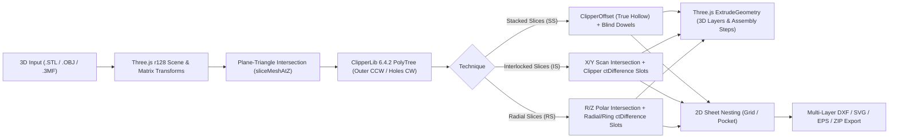

# OpenSlicer Studio

**English Version** | [Türkçe Sürüm](README.tr.md)

**OpenSlicer Studio** is a modern, zero-install, browser-based (Single-File HTML) open-source reimagining and extension of Autodesk® *Slicer for Fusion 360* (formerly *123D Make*). It converts 3D models (`.STL`, `.OBJ`, `.3MF`) into fabrication-ready 2D cutting plans (`.DXF`, `.SVG`, `.EPS`) for laser cutters, CNC routers, and cardboard/wood physical model making.

It combines modern 3D scene workflows inspired by OrcaSlicer / Bambu Studio (*3D Convex Hull Lay-on-Face*, *Outside-Object Protractor Gimbal*) with an advanced geometric slicing and interlocking joint engine inside a single independent file.

---

## 🚀 Key Features

### 1. Three Fabrication Techniques (Construction Techniques)
* **Stacked Slices (`SS`):**
  * Slices the 3D model with parallel horizontal planes based on user-defined material thickness and layer skipping.
  * **Parametric True Hollow:** Computes exact parallel interior offsets across every layer using `ClipperLib.ClipperOffset`, automatically protecting top and bottom solid caps.
  * **Intelligent Dual-Plane Dowel System:** Interactive draggable dowels between upper and lower planes. Automatically caps the top layer as a blind-hole cap, supports multi-island solid blocks, and calculates a full Dowel Cut Summary list.
* **Interlocked Slices (`IS` - Waffle Grid):**
  * Slices the model along orthogonal `X` and `Y` axes, cutting half-lap (*halving joint*) interlocking slots at every `(X_i, Y_j)` rib intersection.
  * **Physical Assembly Hierarchy:** `Y` ribs (`Y-1..Y-m`) act as the base foundation lattice on the table with top-down slots; `X` ribs (`X-1..X-n`) slide down from above (`+Z`) with bottom-up slots.
  * **Slot Destination Guide Labels:** Engraves corresponding target rib IDs (`Y-3`, `X-2`) at the bottom of each slot to guide assembly.
  * **CNC Corner Relief & Chamfer:** Applies **T-Bone** or **Dog Bone** corner reliefs based on tool bit diameter and **Notch Factor** lead-in vector chamfers at slot entries.
  * **Linear Rib Sliding:** Selected `X` or `Y` ribs can be slid along their axis directly in 3D or via a slider, bounded to prevent jumping over adjacent neighbors, and reset individually.
* **Radial Slices (`RS` - Polar Slicing):**
  * Slices the model around its vertical central axis with angled radial fins (`R-1..R-n`) and horizontal circular rings (`Z-1..Z-m`).
  * **Angle-Invariant Halving Joints:** Outer radial slots for horizontal rings and inner horizontal slots for vertical fins.
  * **Full CNC Corner Relief & Chamfers:** Dog-Bone, T-Bone, and vector lead-in chamfers work seamlessly on radial geometries.
  * **Radial Inward Slide Animation:** Assembly steps animate vertical fins sliding radially inward along $(\cos\theta_i, \sin\theta_i, 0)$.

---

### 2. CAD Integration & Universal Live File Watcher
* **Universal Live File Watcher (Browser):**
  * Powered by the File System Access API (`window.showOpenFilePicker`), watch any STL or OBJ exported by any CAD software (Autodesk Fusion 360, Blender, Rhino, SolidWorks, FreeCAD).
  * The file on disk is polled every ~850ms. When re-exported or saved in your CAD software, the 3D model reloads instantly in OpenSlicer Studio without resetting camera orientation, position, slicing technique, or manufacturing parameters.
* **Autodesk Fusion 360 Add-In (`OpenSlicerBridge`):**
  * A lightweight personal add-in script for Fusion 360.
  * Exports the active design to your chosen target folder with 1-click or save hotkey using dynamic `[Project]-[Body].stl` naming.

---

### 3. Large-Scale CNC (5m–10m+) & Robust 3D Scene
* **Dynamic Grid & Camera Scaling:** When large architectural or furniture scale models (5000–10000mm+) are loaded, floor grid spacing (50/100/200/500mm), camera `near`/`far` planes, and ground dimension lines scale proportionally, preventing scene clipping and distortion.
* **Zero Z-Fighting:** Materials utilize `polygonOffset` to prevent depth flickering between solid geometry and wireframe outlines.
* **Flicker-Free Autodesk ViewCube:** 6 faces, 12 chamfer edges, and 8 corners use disjoint geometric boundaries, eliminating rotation artifacts.
* **Damped Navigation Zoom:** Magnifier tool zoom speed is tuned (`0.18`) for smooth, controlled inspections.
* **Bidirectional Cut Layout Visibility:** Parts excluded in the 2D Cut Layout immediately restore in the 3D scene when unhidden.

---

### 4. OrcaSlicer & Autodesk Slicer Hybrid 3D Viewport Tools
* **OrcaSlicer 3D Convex Hull "Lay on Face" (`F`):** Computes the 3D convex hull (*QuickHull / Shrink-Wrap*) of the model, merges coplanar facets into candidate stability patches, and snaps the clicked face flush to $Z = 0$ with an exact 5-step matrix alignment.
* **Static Tick Protractor Gimbal:** Both **Slice Direction** and the toolbar **Rotate (`R`)** tool share a consistent interaction:
  * A white 5°/15° protractor ring remains fixed while dragging the directional arrow handle.
  * Cursor **inside** the circle snaps cleanly to **5° increments**; cursor **outside** provides smooth **0.1° free rotation**.
* **Independent Transform Reset (`↺`):** Each transform tool (`Move`, `Rotate`, `Scale`) features an individual reset button without affecting the others.
* **Raw Model Inspection Eye (`👁️`):** Clicking the eye icon hides slice extrusions to display the original imported solid geometry as an opaque mesh (`ghostMesh`), allowing rapid surface topology checks.

---

### 5. 2D Cut Layout, Fullscreen Lightbox & Multi-Layer Export
* **2D Sheet Nesting:** Automatically arranges parts across stock sheets according to sheet dimensions, margins, and tool diameter. Supports multi-selection (`Ctrl+Click`, `Shift+Click`) and part exclusion.
* **Fullscreen Sheet Lightbox:** Double-clicking any sheet card in the 2D panel opens a full-viewport canvas with cursor-centered zoom, click-drag panning, and keyboard sheet navigation (`◀` / `▶`).
* **Multi-Layer `.DXF`, `.SVG`, `.EPS`, and `.ZIP` Export:**
  * Outputs color-coded layers tailored for laser cutters and CNC CAM software (AutoCAD, Vectric Aspire, Fusion 360, LightBurn):
    * `OUTER_CUT` (Red - ACI 1): Outer contours and interlocking slot cuts
    * `INNER_CUT` (Yellow - ACI 2): Interior holes and hollows
    * `DOWEL_HOLES` (Green - ACI 3): Alignment pin/dowel holes
    * `LABELS_PART` (Cyan - ACI 4): Part numbering (`Z-1`, `X-1`, `Y-1`, `R-1`)
    * `GUIDES` (Blue - ACI 5): Stack alignment guide outlines
    * `LABELS_SLOT` (Magenta - ACI 6): Interlocking slot destination guide IDs (`Y-3`, `X-2`)
    * `SHEET_BORDER` (White - ACI 7): Sheet boundary outline
  * 100% compliant with **AutoCAD R12 (`AC1009` `POLYLINE` + `VERTEX` + `SEQEND`)** specification for universal CAM compatibility.

---

## ⚙️ Technical Architecture

OpenSlicer Studio operates as a standalone **single-file application (`index.html`)** without build steps:

---

## 📋 Status & Roadmap

### ✅ Completed Features
- [x] **P0 — Geometric Precision & ClipperLib Core:**
  - [x] `ClipperLib` (`PolyTree` & `ClipperOffset`) integration for holes and true parallel hollowing.
  - [x] OrcaSlicer 3D Convex Hull **Lay on Face (`F`)** system.
  - [x] Pole-of-Inaccessibility intelligent label positioning (`findSmartSliceLabelPosition`).
  - [x] Multi-island dual-plane blind dowel system with dowel length cut summary.
- [x] **P0+ — Scene Controls & Gimbal Ergonomics:**
  - [x] Fixed-ring protractor gimbal with 5° interior snap and 0.1° exterior free rotation.
  - [x] Independent transform resets (`↺`) for Move, Rotate, and Scale.
  - [x] Dynamic dowel plane reorientation upon slice angle changes.
  - [x] Raw model inspection eye (`👁️`) toggle.
- [x] **P2 — Interlocked Slices (Waffle Grid) & CNC Suite:**
  - [x] Orthogonal `X`/`Y` waffle slicing engine with automated joint slot generation.
  - [x] Slot mating labels (`Y-3`, `X-2`).
  - [x] Multi-layer AutoCAD R12 pure DXF generator.
  - [x] Dog-Bone, T-Bone, and Notch Factor vector lead-in chamfer algorithms.
  - [x] Instant magenta collision highlights and continuous assembly slider.
  - [x] Neighbor-clamped linear rib sliding.
  - [x] Fullscreen sheet lightbox and single-line CNC stroke font (`SINGLE_LINE_FONT`).
- [x] **P2+ (Phase 1) — Radial Slices, CAD Live Watch & Large Scale CNC (v1.2 Beta):**
  - [x] **Radial Slices (`RS`):** Radial fins (`R-1..R-n`) + horizontal rings (`Z-1..Z-m`) with radial assembly animations.
  - [x] **Large Scale CNC (5m–10m+):** Dynamic grid and camera near/far adaptations.
  - [x] **Universal Live File Watcher:** Live CAD re-export monitoring via File System Access API.
  - [x] **Autodesk Fusion 360 Add-in (`OpenSlicerBridge`):** 1-click STL bridge.
  - [x] **Flicker-Free ViewCube & Cut Layout unhide visibility bug fixes.**
  - [x] **beta 1.2 Header Badge, Buy Me a Coffee Integration & GNU GPLv3 License.**

---

### 🗺️ Future Roadmap
- [ ] **1st Priority (`P2+` Continuation) — Remaining Techniques:**
  - [ ] **Curve Slices (`CS`):** Slicing along arbitrary user splines/spines.
  - [ ] **Folded Panels / Pepakura (`FP`):** Low-poly sheet metal and cardboard folding unrolls.
- [ ] **Final Phases (`P1` & `P3`) — Project Backup, Nesting & Scene Refinements:**
  - [ ] **P1 — Full `.3MF` Project Save / Load:** Complete state backup including model transforms, slices, dowels, and part exclusions.
  - [ ] **P1+ — Assembly Interference Analysis:** Step-by-step physical interlock validation.
  - [ ] **P3 — True Polygon Nesting, Web Worker & 3D Gizmos:**
    - [ ] Irregular polygon packing algorithm.
    - [ ] Offloading heavy Clipper operations to Web Workers.
    - [ ] Modern 3D on-object gizmos for Move and Scale tools.

---

## ☕ Support
OpenSlicer Studio is an independent, free, and open-source fabrication tool. If you find it helpful and would like to support ongoing development:

---

## 🙏 Credits & Open Source Acknowledgments

OpenSlicer Studio is built upon powerful open-source libraries, computer geometry algorithms, and historical slicer concepts. Sincere thanks to the original creators and maintainers:

### Included Open Source Libraries:
* **[Three.js](https://threejs.org/) (r128)** — *MIT License* (© Ricardo Cabello / mrdoob and Three.js Contributors)
  * Core 3D engine, WebGL renderer, `OrbitControls`, `TransformControls`, `STLLoader`, `OBJLoader`, `ConvexHull`, and `ConvexGeometry`.
* **[ClipperLib](https://sourceforge.net/projects/polyclipping/) (v6.4.2 JS Port)** — *Boost Software License 1.0 (BSL-1.0)* (© Angus Johnson & Timo)
  * 2D polygon Boolean operations (`ctDifference`, `ctUnion`), `PolyTree` hole classification, and `ClipperOffset` parallel hollowing.
* **[JSZip](https://stuk.github.io/jszip/) (v3.10.1)** — *MIT / GPLv3 Dual License* (© Stuart Knightley, David Duponchel, Franz Buchinger, António Afonso)
  * `.3mf` model package parsing and multi-sheet production zip archive bundling.

### Algorithmic References & Typography:
* **Single-Line Stroke Vector Font:** Continuous-stroke vector typography avoiding double-line laser cuts (Hershey Fonts & CNC typography principles).
* **Pole of Inaccessibility:** Intelligent inside-polygon label positioning inspired by the Mapbox `polylabel` concept.
* **Monotone Chain & QuickHull:** A. M. Andrew (1979) and Barber et al. (1996) convex hull algorithms for stability patch extraction.

### Design Pedigree & Inspirations:
* **Autodesk® Slicer for Fusion 360 (formerly 123D Make):** Core fabrication philosophy for stacked, waffle, and radial slicing techniques.
* **OrcaSlicer / Bambu Studio / PrusaSlicer:** Convex hull lay-on-face alignment, static protractor angle gimbal, and modern 3D slicer viewport ergonomics.

---

## 📄 License
This project is licensed under the **GNU General Public License v3.0 (GPLv3)**. See the [LICENSE](LICENSE) file for complete details.

---

## ⚖️ Legal Disclaimer & Trademarks
* **Autodesk®**, **Fusion 360®**, and **123D Make®** are registered trademarks of Autodesk, Inc. in the United States and/or other countries.
* **OpenSlicer Studio** is an independent, open-source community project and is not affiliated with, endorsed by, sponsored by, or connected to Autodesk, Inc. in any way. All brand names and product references are used strictly for identification and historical compatibility/educational purposes under nominative fair use.

---

## 💻 Running OpenSlicer Studio
Requires no installation, server, or build step. Simply open [index.html](index.html) in any modern web browser (Google Chrome, Microsoft Edge, Mozilla Firefox, Brave) or run via GitHub Pages.
