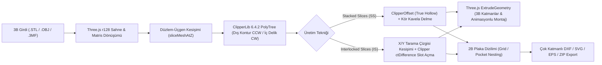

# OpenSlicer Studio

**OpenSlicer Studio**, Autodesk® *Slicer for Fusion 360* (eski adıyla *123D Make*) uygulamasının modern, tarayıcı tabanlı (Zero-Install / Single-File HTML) yeniden yorumlanması ve geliştirilmiş açık mimarili alternatifidir. 3B modelleri (`.STL`, `.OBJ`, `.3MF`) lazer kesim, CNC router veya karton/ahşap maket üretimi için 2B kesim planlarına (`.DXF`, `.SVG`, `.EPS`) dönüştürür.

OrcaSlicer / Bambu Studio'nun modern 3B sahne araçlarını (*3B Dışbükey Zarf ile Yüzeye Oturtma*, *Sabit Çentikli İletki Gimbalı*) ve Autodesk Slicer'ın üretim odaklı dilimleme/geçme motorunu tek bir bağımsız dosyada birleştirir.

---

## 🚀 Temel Özellikler

### 1. İki Farklı Üretim Tekniği (Construction Techniques)
* **Stacked Slices (`SS` - Üst Üste Yığılmış Katmanlar):**
  * Modeli belirlenen malzeme kalınlığına (`Material Thickness`) ve katman atlama (`Skip Layers`) değerine göre paralel düzlemlerle dilimler.
  * **Parametrik Kabuk / Oyma (True Hollow):** `ClipperLib.ClipperOffset` kullanarak her katmanda gerçek paralel iç ofset hesaplar; alt ve üst kapak katmanlarını otomatik korur.
  * **Akıllı Kavela / Pim Sistemi (Dual-Plane Blind Dowels):** Modelin üst ve alt çalışma düzlemleri arasında sürüklenebilir kavelalar oluşturur. En üst geçerli katmanı "kör delik kapağı" (blind-hole cap) olarak bırakır, çoklu bağımsız blokları destekler ve kavela kesim boyu listesini (*Dowel Cut Summary*) otomatik çıkarır.
* **Interlocked Slices (`IS` - Geçmeli Izgara / Waffle):**
  * Modeli birbirine dik `X` ve `Y` eksenlerinde dilimler ve her `(X_i, Y_j)` kesişiminde yarı-yarıya (*halving joint*) geçme yuvaları (slotlar) açar.
  * **Fiziksel Montaj Sırası:** `Y` dilimleri (`Y-1..Y-m`) masaya ilk dizilen taban ızgarası olarak üstten aşağıya (*top-down*) slot alır; `X` dilimleri (`X-1..X-n`) ise üstten (`+Z`) aşağıya doğru takılacak şekilde alttan yukarıya (*bottom-up*) slot alır.
  * **Slot Karşılık Kılavuz Etiketleri:** Her geçme yuvasının dibine, o yuvaya hangi karşı parçanın gireceğini gösteren kılavuz kodlar (`Y-3`, `X-2` vb.) yazar.
  * **CNC Köşe Boşaltma (Corner Relief) & Pah:** Slot diplerine CNC uç çapına (`Tool Diameter`) göre **T-Bone** veya **Dog Bone** boşaltması ve slot ağzına **Notch Factor** giriş pahı uygular.
  * **Eksen Boyunca Kaydırma (Linear Rib Sliding):** Seçilen herhangi bir `X` veya `Y` dilimi 3B sahnede fareyle sürüklenerek veya sağ paneldeki slider ile kendi ekseninde kaydırılabilir ve parça bazlı (`↺`) sıfırlanabilir.

### 2. OrcaSlicer & Autodesk Slicer Hibrit 3B Sahne Araçları
* **OrcaSlicer 3B Convex Hull "Lay on Face" (`F`):** Modelin 3B dışbükey zarfını (*QuickHull / Shrink-Wrap*) hesaplar, eş-düzlemli üçgenleri birleştirerek modelin üzerine oturabileceği kararlı düz yüzey adaylarını beyaz yamalar halinde gösterir. Tıklanan yüzeyi 5 adımlı matris dönüşümüyle tam `Z = 0` tablasına oturtur.
* **Sabit Çentikli İletki Gimbalı (Protractor Gimbal):** Hem **Slice Direction** (dilimleme açısı) hem de üst menüdeki **Rotate (`R`)** aracı aynı doğal etkileşimi kullanır:
  * Beyaz 5°/15° çentikli çember sabit durur; kullanıcı renkli ok tutamacını çember boyunca sürükler.
  * Fare imleci çemberin **içindeyken 5° açılara mıknatıslanır (`Snap 5°`)**, çemberin **dışına çıktığında serbest (`Free 0.1°`)** döner.
* **Bağımsız Transform Sıfırlama (`↺`):** Üst araç çubuğundaki `Move`, `Rotate` ve `Scale` araçlarının her biri birbirini bozmadan kendi `↺` butonuyla bağımsız sıfırlanabilir.
* **Orijinal Model İnceleme Gözü (`👁️`):** Sol menüdeki göz simgesi kapatıldığında dilimlenmiş katmanlar gizlenir ve içe aktarılan ham 3B model **opak (katı)** olarak gösterilir; böylece yüzey hataları doğrudan incelenebilir.
* **3B Autodesk ViewCube & Kamera:** Sağ üst köşede tıklanabilir `TOP`, `FRONT`, `RIGHT`, `BACK`, `LEFT`, `BOTTOM` ve `🏠 Home` görünüm küpü ile **Perspektif / Ortografik** kamera geçişi bulunur.

### 3. 2B Kesim Yerleşimi (Cut Layout), Tam Ekran Lightbox ve Çok Katmanlı Export
* **2B Nesting & Çift Yönlü Seçim:** Parçaları plaka boyutu (`Sheet Width / Height`), kenar payı (`Margin`) ve takım çapına (`Tool Diameter`) göre plakalara yerleştirir. 3B sahnede veya 2B plakada `Click`, `Ctrl+Click` ve `Shift+Click` ile çoklu parça seçimi ve parça gizleme/hariç tutma (*Exclude Part*) yapılabilir.
* **Tam Ekran Sheet Lightbox:** Sağ paneldeki herhangi bir plaka kartına **çift tıklandığında** 3B sahne üzerinde tam ekran inceleme penceresi açılır (fare tekerleği ile imlece doğru zoom, sol tıkla pan, `◀`/`▶` ile sayfalar arası geçiş).
* **Çok Katmanlı (Multi-Layer) `.DXF`, `.SVG`, `.EPS` ve `.ZIP` Çıktısı:**
  * CAD/CAM yazılımları (AutoCAD, Vectric Aspire, Fusion 360, LightBurn) için ayrı katman ve renklerde üretim çıktısı verir:
    * `OUTER_CUT` (Kırmızı - ACI 1): Dış kesim konturları ve geçme yuvaları
    * `INNER_CUT` (Sarı - ACI 2): İç boşluklar ve delikler
    * `DOWEL_HOLES` (Yeşil - ACI 3): Kavela delikleri
    * `LABELS_PART` (Camgöbeği - ACI 4): Parça numaraları (`Z-1`, `X-1`, `Y-1`)
    * `GUIDES` (Mavi - ACI 5): Bir sonraki katman hizalama kılavuzları
    * `LABELS_SLOT` (Macenta - ACI 6): Geçme yuvası karşılık kodları (`Y-3`, `X-2`)
    * `SHEET_BORDER` (Beyaz - ACI 7): Plaka sınır çerçevesi

---

## ⚙️ Nasıl Çalışır? (Teknik Mimari)

Uygulama hiçbir sunucu veya derleme (build) adımı gerektirmeyen **tek dosya (`SlicerStudio.html`)** mimarisiyle çalışır:

1. **Düzlem-Üçgen Kesişim Motoru (`sliceMeshAtZ`):**
   * Modelin dünya matrisi ve dilimleme açısı (`sliceAngX`, `sliceAngY`) model merkezine göre uygulandıktan sonra her kesit düzleminde (`Z`, `X` veya `Y`) üçgen yüzeylerle düzlem kesişim segmentleri çıkarılır ve kapalı çokgen zincirleri oluşturulur.
2. **ClipperLib 2B Boolean & Topoloji Sınıflandırma (`classifySliceLoopsWithClipper`):**
   * Ham kesişim halkaları `1000` ölçek çarpanı (`0.001 mm` hassasiyet) ile `ClipperLib.PolyTree` (`pftEvenOdd`) üzerinden geçirilir. Böylece iç içe geçmiş boru/vazo/simit geometrilerinde dış kabuklar (`CCW`) ile gerçek iç delikler (`CW`) matematiksel olarak ayrıştırılır.
3. **Geçmeli Izgara (Waffle) Yarı-Yarıya Kesişim Hesabı:**
   * Her `(X_i, Y_j)` düzlem çiftinin kesişim doğrusunda dikey dolu aralıklar (`getVerticalSolidIntervalsAtU`) bulunur. Kesişen `[zBot, zTop]` aralıklarının tam ortası (`zMid`) hesaplanarak `Y` parçasına üstten, `X` parçasına alttan `ClipperLib.ClipType.ctDifference` ile slot açılır ve dikey montaj yolunu tıkayan ters açılar (overhang/multi-span) çarpışma olarak raporlanır.

---

## 📋 Proje Durumu ve TODO Listesi

### ✅ Tamamlanan Özellikler (Completed)
- [x] **P0 — Geometrik Doğruluk ve ClipperLib Altyapısı:**
  - [x] `ClipperLib` (`PolyTree` & `ClipperOffset`) entegrasyonu ile gerçek iç delik (Mesh Hole) ve paralel iç ofset (True Hollow) desteği.
  - [x] Üçgen normallerinden ve 3B Dışbükey Zarftan (*3D Convex Hull / QuickHull*) çalışan 5 adımlı OrcaSlicer **Lay on Face (`F`)** sistemi.
  - [x] Poligon içi en geniş boşluğu bulan (*Pole of Inaccessibility*) akıllı etiket konumlandırma (`findSmartSliceLabelPosition`).
  - [x] Çift çalışma düzlemli, çoklu blok ve kör delik (*blind-hole*) destekli akıllı kavela sistemi ve kavela kesim boyu özeti.
- [x] **P0+ — Sahne Kontrolleri ve Gimbal İyileştirmeleri:**
  - [x] Hem `Slice Direction` hem de üst menü `Rotate (R)` için sabit çentikli, çember içi `5°` snap / çember dışı serbest dönüş destekli OrcaSlicer iletki gimbalı.
  - [x] `Move`, `Rotate`, `Scale` için birbirinden bağımsız sıfırlama (`↺`) butonları.
  - [x] Dilimleme açısı değiştiğinde kavela düzlemlerinin model merkezine göre dönmesi ve dinamik boyutlanması.
  - [x] Model menüsündeki Göz (`👁️`) butonuna basıldığında dilimlerin gizlenip ham modelin opak (katı) olarak gösterilmesi.
- [x] **P2 (Faz 1 & Faz 2) — Interlocked Slices (Waffle), CNC Boşaltma & Arayüz Paketi:**
  - [x] `X` ve `Y` eksenli geçmeli ızgara (Waffle) dilimleme motoru, Waffle modunda `Hollow` ve `Dowels` kutularının otomatik gizlenmesi.
  - [x] Slot diplerine karşılık gelen parçanın kodunu (`Y-3`, `X-2`) yazan kılavuz etiket sistemi ve parça etiketlerinin (`X-4`) slot etiketleriyle çakışmasını önleyen akıllı konumlandırma (`findSmartSliceLabelPosition`).
  - [x] Çok katmanlı (`OUTER_CUT`, `INNER_CUT`, `DOWEL_HOLES`, `GUIDES`, `LABELS_PART`, `LABELS_SLOT`, `SHEET_BORDER`) ve %100 **AutoCAD R12 (`AC1009` `POLYLINE` + `VERTEX` + `SEQEND`)** uyumlu DXF altyapısı (Illustrator & Fusion 360 tam uyumlu).
  - [x] **Dog Bone** ($\pm R/\sqrt{2}$ 3 noktadan teğet iç köşe merkezi) ve **T-Bone** (dikey duvar merkezli yarım daire) hassas CNC köşe boşaltma geometrisi.
  - [x] **Notch Factor (Gerçek 2B Vektör Köşe Chamfer):** Kesilen parçanın nihai 2B vektör poligonu (`outerLoops`) üzerindeki slot ağzı köşelerinde hem dikey slot duvarı hem de parçanın gerçek dış konturu boyunca yürüyerek basamaksız pah kıran `applyVectorSlotMouthChamfers` algoritması.
  - [x] **Ana Ekranda Anında Çarpışma Vurgusu & Assembly Steps:** Model dilimlendiği anda (`syncDefaultCollidingSliceIds`) fiziksel olarak birbirine geçemeyen parçaların ana 3B ekranda **parlak macenta (`#d946ef`)** rengiyle gösterilmesi; kesintisiz (`step="0.02"`) slider hareketi ve `Prev`/`Next` adımlarında parçanın yuvasından çıkıp bir sonraki adıma kadar havada beklemesi.
  - [x] Seçili Waffle dilimini komşu parçaların (`i-1`, `i+1`) ötesine geçmeyecek şekilde (`Neighbor Clamping`) kendi ekseninde kaydırma ve parça bazlı sıfırlama hapları (`Shifted Ribs ↺`).
  - [x] 2B Cut Layout kartlarına çift tıklayınca açılan, zoom/pan destekli tam ekran **Sheet Lightbox**, `non-scaling-stroke` ince kesim çizgileri, plaka boyutuna orantılı (`getSheetLabelFontSizes`) **Single-Line (Tek Çizgi) CNC Vektör Font** (`SINGLE_LINE_FONT`).
  - [x] Uygulamanın temiz/boş tabla ile açılması ve yeni üretim presetleri (`300x300x3mm`, `86x54x0.4mm`, `210x297x0.1mm`, `0.05mm`'ye kadar ince malzeme desteği).

---

### 🗺️ Planlanan Özellikler (Roadmap — Öncelik Sırasına Göre)
- [ ] **1. Öncelik (`P2+`) — Yeni Üretim / Dilimleme Teknikleri (Construction Techniques):**
  - [ ] **Radial Slices (`RS`):** Merkez eksen etrafında ışınsal/dairesel dilimleme (`R-1..R-n` kanatlar) + yatay halka geçmeler (`Z-1..Z-m`).
  - [ ] **Curve Slices (`CS`):** Kullanıcı tanımlı eğri (spline) boyunca dilimleme.
  - [ ] **Folded Panels / Pepakura (`FP`):** Düşük poligonlu (Low-Poly) sac/karton katlama açınımı.
- [ ] **Son Aşamalar (`P1` & `P3`) — Proje Yedekleme, Nesting & Sahne İyileştirmeleri:**
  - [ ] **P1 — Tam Kapsamlı `.3MF` Proje Kaydet / Yükle (Full Project Backup):** 3B modeli, uygulanan dönüşümleri, dilimleme parametrelerini, kavela koordinatlarını, kaydırılmış Waffle dilim ofsetlerini ve hariç tutulan parçaları tek bir `.3mf` dosyası olarak kaydetme ve geri yükleme.
  - [ ] **P1+ — Montaj Engelleyen Parça Analizi:** Parçaların takılma sırasına göre birbirini kilitleyen geometrilerin detaylı 3B montaj analizi.
  - [ ] **P3 — Gerçek Poligon Nesting, Web Worker & Özel Test Modeli:**
    - [ ] Tüm dilimleme tekniklerini test etmeye uygun yerleşik (built-in) özel bir başlangıç 3B modelinin eklenmesi.
    - [ ] Bounding-box dizilimi yerine açılı ve sıkı poligon paketleme (*Nesting*).
    - [ ] `runSlicer()` ve Clipper işlemlerinin `Web Worker` içine taşınması ve üst menüdeki `Move`/`Scale` araçlarının OrcaSlicer tarzı özel 3B gizmo tasarımına geçirilmesi.

---

## 💻 Çalıştırma
Herhangi bir kurulum gerektirmez. `SlicerStudio.html` dosyasını modern bir web tarayıcısında (Chrome, Edge, Firefox, Brave) doğrudan açarak kullanabilirsiniz.
